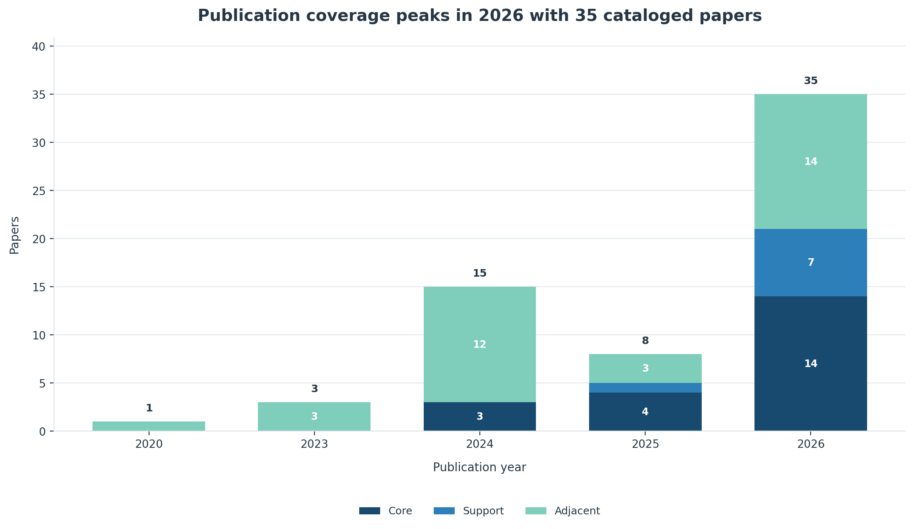
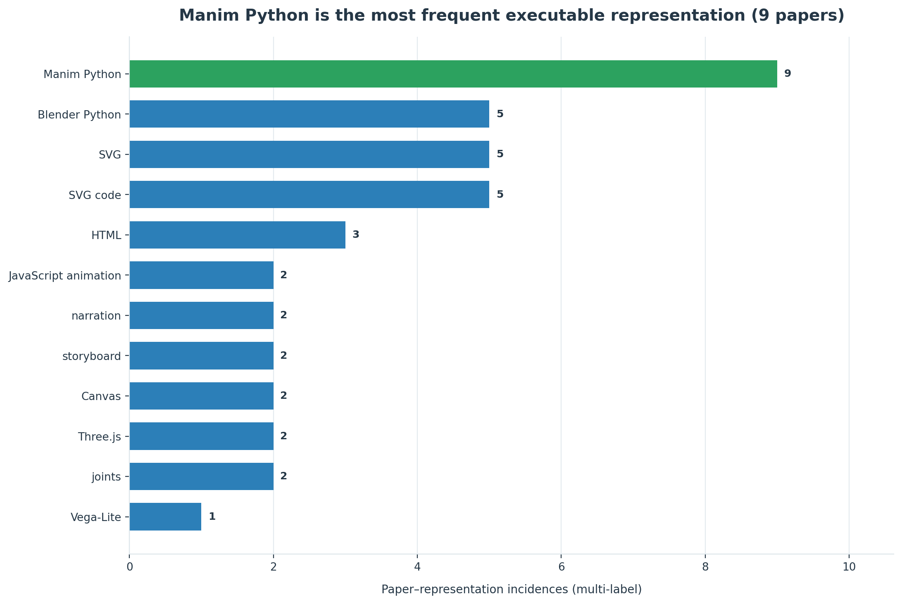
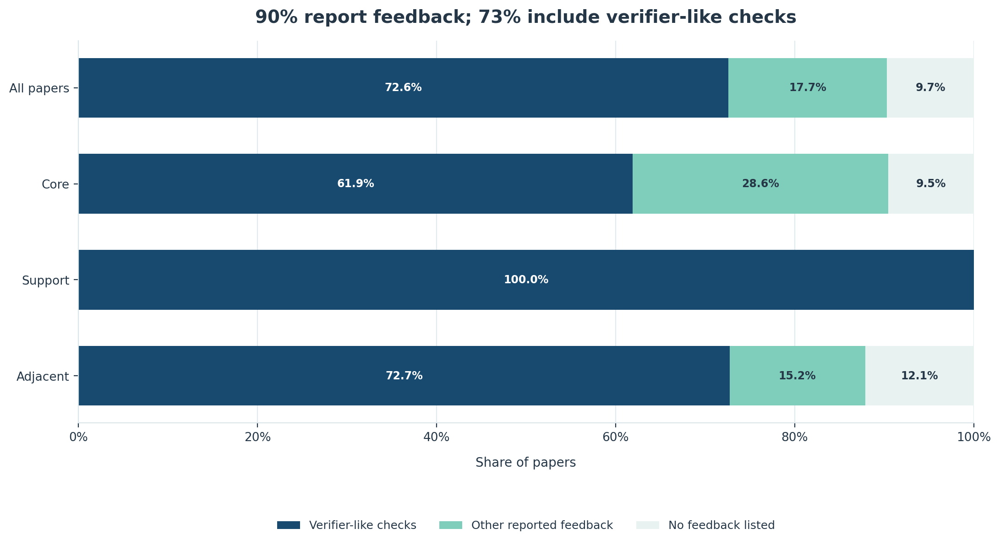
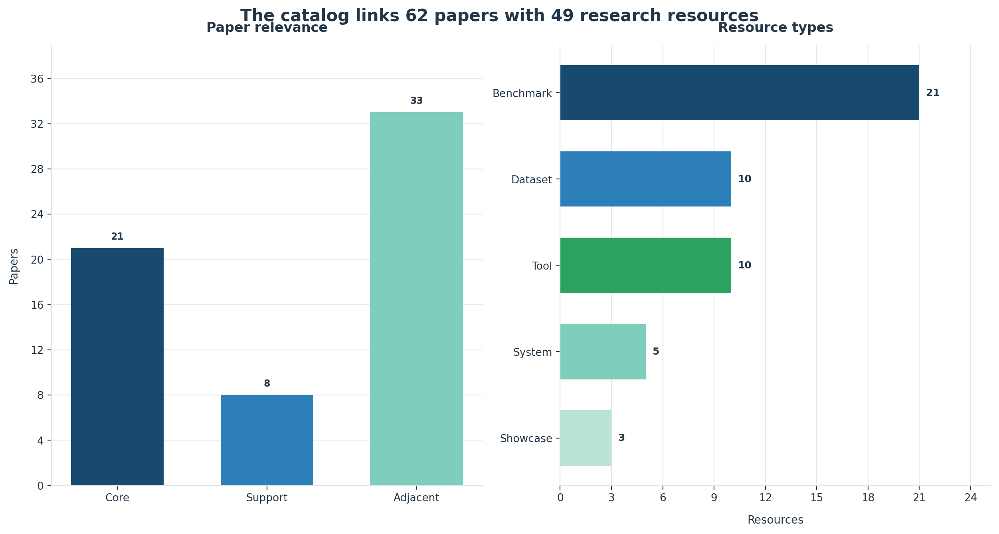

# Awesome Code-Generated Video

   

A research-first map of systems in which models generate **executable visual programs**—Manim, Blender Python, HTML/CSS/JS, SVG/Lottie, Remotion, simulation or engine programs—and identified runtimes render those programs into animation or video.

[简体中文](README.zh-CN.md) · [Repository](https://github.com/Daryl-GSJ/awesome-code-generated-video) · [Taxonomy](taxonomy.md) · [Research gaps](research-gaps.md) · [Paper data](data/papers.json) · [Resource data](data/resources.json)

> **Evidence cutoff: 2026-10-27.** The repository normalizes four full research briefs, merges preprints with published versions, preserves uncertainty as `null`/`[]`, and favors the more conservative reading when sources conflict.

## Catalog snapshot

The normalized data currently contains **62 papers/works**—**21 core**, **8 support**, and **33 adjacent**—plus **49 resources**. Publication coverage is concentrated in 2026 (**35 papers**). **56/62 papers (90.3%)** list feedback, and **45/62 (72.6%)** include verifier-like executable, rendered, structural, symbolic, metric, rule, test, or state checks under the reproducible heuristic documented in [`analysis.md`](analysis.md).

  

<em>Annual catalog coverage, split by relevance tier.</em>

  

<em>Top exact representation labels; papers may have multiple labels.</em>

  

<em>Metadata coverage for reported feedback and verifier-like checks.</em>

  

<em>Paper relevance mix and the types of indexed research resources.</em>

## Definition

A work is **direct core** when a model or agent creates or materially edits a **time-bearing executable visual representation**, an identified runtime executes it, and animation/video is a primary output or evaluation target.

This includes executable animation code, declarative temporal formats, verified traces and world/event programs. It does **not** include ordinary pixel-space video generation, code used only as an input condition, prose-only scripts/storyboards, or static scenes merely capable of being filmed. Benchmarks, verifiers, inverse reconstruction and hybrid code→pixel systems are retained as **support**; static visual/3D program work with a concrete temporal transfer is **adjacent**.

See [`taxonomy.md`](taxonomy.md) for operational tests, edge cases and deduplication rules.

## Scope at a glance

| Axis | In scope |
|---|---|
| Inputs | text, paper, theorem/problem, table, image/keyframe, reference video, existing project + edit |
| Programs | Manim/Blender Python, HTML/CSS/JS, D3.js, SVG/CSS/SMIL, Lottie JSON, Remotion, engine/simulation code, typed IR/DSL |
| Tasks | T2V-code, I2V-code, V2V-code, Edit-code, long-form explanation, data story, motion graphics, physics/3D/cutscene |
| Feedback | compiler/runtime, renderer-in-the-loop, VLM critic, symbolic geometry, temporal predicates, schema/tests, human gate |
| Evaluation | safety, complete render, spatial/temporal/semantic quality, edit locality, outcome, reproducibility and lifecycle cost |

## Core papers

Every item is deliberately one line; follow **Data** for normalized details and **Brief** for evidence and caveats.

### Educational and explanatory video

- **TheoremExplainAgent** (2025) — planner → Manim for multi-minute STEM explanations; [Paper](https://arxiv.org/abs/2502.19400) · [Project](https://tiger-ai-lab.github.io/TheoremExplainAgent/) · [Data](data/papers.json) · [Brief](research/core.md)
- **Manimator** (2025) — paper/PDF → scene plan → Manim; no video-feedback loop; [Paper](https://arxiv.org/abs/2507.14306) · [Code](https://github.com/HyperCluster-Tech/manimator) · [Data](data/papers.json) · [Brief](research/core.md)
- **Code2Video** (ICML 2026) — planner–coder–critic, scoped repair and TeachQuiz; [Paper](https://arxiv.org/abs/2510.01174) · [Code](https://github.com/showlab/Code2Video) · [Data](data/papers.json) · [Brief](research/core.md)
- **LLM2Manim** (2026) — pedagogy-aware planning, symbol ledger and expert gate; [Paper](https://arxiv.org/abs/2604.05266) · [Data](data/papers.json) · [Brief](research/core.md)
- **PhysicsSolutionAgent** (2026) — runtime logs + screenshot VLM feedback for physics explanations; [Paper](https://arxiv.org/abs/2601.13453) · [Code](https://github.com/f20220374/PhysicsSolutionAgent) · [Data](data/papers.json) · [Brief](research/core.md)
- **LASEV** (KDD 2026) — constrained executable scripts and template compilation at deployment scale; [Paper](https://arxiv.org/abs/2602.11790) · [Project](https://robitsg.github.io/LASEV/) · [Data](data/papers.json) · [Brief](research/core.md)
- **ManimTrainer / ManimAgent** (2026) — SFT/GRPO plus renderer- and documentation-in-the-loop inference; [Paper](https://arxiv.org/abs/2604.18364) · [Code](https://github.com/SuienS/manim-trainer) · [Data](data/papers.json) · [Brief](research/core.md)
- **ANVIL** (2026) — analogy → screenplay → Manim with static repair and teacher review; [Paper](https://arxiv.org/abs/2605.16295) · [Code](https://github.com/yurinoviello/AI_Metaphors) · [Data](data/papers.json) · [Brief](research/core.md)
- **ALGOGEN** (Findings of ACL 2026) — verified algorithm traces compiled deterministically to multiple renderers; [Paper](https://arxiv.org/abs/2605.12159) · [Project](https://algenlab.github.io/algogen/) · [Data](data/papers.json) · [Brief](research/core.md)
- **ManimAgent: Self-Evolving Multimodal Agents** (EMNLP 2026) — episodic success/failure memory with blind human Pass@1; [Paper](https://arxiv.org/abs/2606.30296) · [Code](https://github.com/jwj1342/Paper2Manim) · [Data](data/papers.json) · [Brief](research/core.md)

### Web, vector and motion graphics

- **LogoMotion** (CHI 2025) — visually grounded JavaScript synthesis, repair and code-connected controls; [Paper](https://arxiv.org/abs/2405.07065) · [Data](data/papers.json) · [Brief](research/vector_web.md)
- **MG-Gen** (2025) — raster design → layered HTML → JavaScript motion graphics; [Paper](https://arxiv.org/abs/2504.02361) · [Code](https://github.com/CyberAgentAILab/MG-GEN) · [Data](data/papers.json) · [Brief](research/vector_web.md)
- **DATAREEL** (2026) — table → plan → HTML/D3.js with plan and video critics; [Paper](https://arxiv.org/abs/2604.25220) · [Code](https://github.com/vis-nlp/DataReel) · [Data](data/papers.json) · [Brief](research/core.md)
- **LottieGPT** (CVPR 2026) — autoregressive generation of editable Lottie animation programs; [Paper](https://arxiv.org/abs/2604.11792) · [Code](https://github.com/yisuanwang/LottieGPT) · [Data](data/papers.json) · [Brief](research/core.md)
- **InternSVG** (ICLR 2026) — unified SVG tasks including text/video-to-dynamic SVG; [Paper](https://arxiv.org/abs/2510.11341) · [Project](https://hmwang2002.github.io/release/internsvg/) · [Data](data/papers.json) · [Brief](research/core.md)
- **VAnim** (ICML 2026) — persistent SVG DOM + sparse state updates + rendering-aware training; [Paper](https://arxiv.org/abs/2605.01517) · [Data](data/papers.json) · [Brief](research/vector_web.md)
- **Keyframer** (CHI 2024) — SVG + language → editable CSS animation through iterative authoring; [Paper](https://arxiv.org/abs/2402.06071) · [Data](data/papers.json) · [Brief](research/vector_web.md)
- **Reels-RSI** (2026) — HTML/SVG/Canvas/Three.js reels with executable rules and program-level memory; [Paper](https://arxiv.org/abs/2610.14495) · [Code](https://github.com/agentic-loops-x/Reels-RSI) · [Data](data/papers.json) · [Brief](research/vector_web.md)

### General, 3D and structured video

- **Kubrick** (2024/2025 workshop record) — multi-agent Blender program generation with VLM review; [Paper](https://arxiv.org/abs/2408.10453) · [Data](data/papers.json) · [Brief](research/core.md)
- **Data Director** (2024) — table insights → Vega-Lite/SVG/timeline/audio data video; [Paper](https://arxiv.org/abs/2408.03876) · [Data](data/papers.json) · [Brief](research/core.md)
- **SimuScene** (2026) — training and evaluation for text → executable physics-inspired animation; [Paper](https://arxiv.org/abs/2602.10840) · [Data](data/papers.json) · [Brief](research/core.md)

## Benchmarks and data

| Resource | What it tests | Key boundary |
|---|---|---|
| [Code2Video-Compass](https://github.com/code2video-compass/Code2Video-Compass) | 2,104 T2V/I2V/V2V tasks on a Remotion web stack | broadest direct benchmark; limited repair, safety and cross-environment study |
| [Animation2Code](https://anya-ji.github.io/animation2code-website/) | video → HTML/CSS/JS; appearance separated from temporal similarity | short web-animation inverse task |
| [MMMC / Code2Video](https://github.com/showlab/Code2Video) | 13-domain professional Manim tutorials and teaching-oriented evaluation | education/Manim specific |
| [TheoremExplainBench](https://tiger-ai-lab.github.io/TheoremExplainAgent/) | 240 theorems in four STEM domains | long-form explanation, not general motion design |
| [MoVer](https://github.com/jama1017/MoVer) | 5,600 prompts with temporal/spatial verification programs | predefined 2D predicate vocabulary |
| [ManiBench](https://github.com/nabin2004/ManiBench) | Manim CE hallucination and visual-logic drift | current paper is a 12-task pilot |
| [4DCodeBench](https://github.com/4DCodeBench/4DCodeBench) | video → executable dynamic 3D scene program | inverse graphics with high execution cost |
| [PhySimCode](https://github.com/SourajaKundu/PhySimCode) | video → physics law, parameters and simulation code | programmatic-to-real gap and non-unique solutions |
| [3DCodeBench](https://github.com/gaoypeng/3dcodebench) | executable Blender code with 2D and 3D evaluation | asset-oriented 3D, adjacent to video |
| [Code4Scene](https://simworld-ai-code4scene.static.hf.space/index.html) | persistent Unreal scene construction/editing and integrity | UE-specific, adjacent to video |

The complete normalized catalog—including LottieBench, SAgoge/SArena, SVGAnim-134k, DATAREEL, SimuScene, transferable video/editing benchmarks and datasets—is in [`data/resources.json`](data/resources.json).

## Systems and tools

- **Runtimes:** [Manim](https://www.manim.community/), [Remotion](https://www.remotion.dev/), [Blender](https://www.blender.org/), browser HTML/SVG/Canvas/Three.js, Unity and Unreal Engine.
- **Procedural/ground-truth infrastructure:** [Infinigen](https://github.com/princeton-vl/infinigen), [Kubric](https://github.com/google-research/kubric), [BlenderProc](https://github.com/DLR-RM/BlenderProc), [AI2-THOR](https://github.com/allenai/ai2thor).
- **Agent engineering:** [BlendHarness](https://github.com/cccky0813/BlendHarness), [blender-agent-studio](https://github.com/ifBars/blender-agent-studio), [blenderwright](https://github.com/HoldMyBeer-gg/blenderwright), [better-blender-mcp](https://github.com/marlonka/better-blender-mcp).
- **Evaluation infrastructure:** [VBench](https://github.com/Vchitect/VBench), [VMAF](https://github.com/Netflix/vmaf), [InterCode](https://github.com/princeton-nlp/intercode), [HumanEval](https://github.com/openai/human-eval). These are transferable components, not direct proof of code-video quality.

## Research observations

1. **Running is not moving correctly.** Animation2Code separates high executability/appearance from much weaker temporal reconstruction; physics and 4D benchmarks show the same static–dynamic gap.
2. **Representation is an algorithmic choice.** Persistent objects, sparse state updates, verified traces and constrained event graphs reduce identity drift and make local repair possible.
3. **Structured evidence beats generic self-critique.** Compiler logs, geometry, temporal predicates, schemas and engine state are more localizable than an ungrounded VLM score; VLMs remain useful for semantics and composition.
4. **Long-form video is a state-management problem.** Layout, narration alignment and cross-scene continuity degrade as duration and dependency depth increase.
5. **Judges require evaluation.** Position bias, same-family preference and misleading visual feedback are observed risks; report critic precision, localization and regressions.
6. **One total score is unsafe.** Use safety/render gates and separate spatial, temporal, semantic, editability, outcome, reproducibility and cost axes.
7. **Hybrid systems are useful but distinct.** A code-rendered draft followed by pixel generation can improve realism, yet loses deterministic final rendering and may reintroduce hallucination.

## Data model and methodology

- [`data/papers.json`](data/papers.json) — one deduplicated record per paper/work; identifiers, links, relevance, representation, generation, feedback, tasks, datasets, evaluation, findings and limitations.
- [`data/resources.json`](data/resources.json) — datasets, benchmarks, systems, tools and showcases.
- [`schema/papers.schema.json`](schema/papers.schema.json) and [`schema/resources.schema.json`](schema/resources.schema.json) — JSON Schema 2020-12 contracts.
- [`research/core.md`](research/core.md), [`research/vector_web.md`](research/vector_web.md), [`research/3d_agents.md`](research/3d_agents.md), [`research/evaluation.md`](research/evaluation.md) — full evidence briefs.

Method: arXiv/full-text first; official proceedings/project/repository pages supplement venue and artifacts; canonical-ID deduplication; no inferred venues, counts, code URLs or licenses; conflicting claims resolved conservatively. Numbers remain author-reported unless a record says otherwise.

## Contributing

Start with [`CONTRIBUTING.md`](CONTRIBUTING.md). Clone the repository with `git clone https://github.com/Daryl-GSJ/awesome-code-generated-video.git`. A useful contribution supplies a primary source, an explicit tier rationale, a real verification date, conservative metadata and schema-valid JSON. Keep README rows scannable; place detail in data and research briefs.

Please follow the [`CODE_OF_CONDUCT.md`](CODE_OF_CONDUCT.md). Repository metadata is dedicated under [CC0-1.0](LICENSE).
