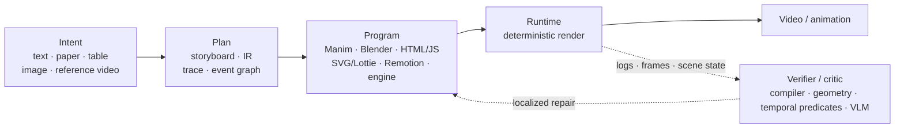

<p align="center">
  
</p>

<p align="center">
  <a href="https://awesome.re"></a>
  <a href="https://github.com/Daryl-GSJ/awesome-code-generated-video"></a>
  <a href="CONTRIBUTING.md"></a>
  <a href="https://github.com/Daryl-GSJ/awesome-code-generated-video/actions/workflows/validate.yml"></a>
  <a href="https://github.com/Daryl-GSJ/awesome-code-generated-video/actions/workflows/links.yml"></a>
  <a href="LICENSE"></a>
  
</p>

<p align="center">
  <b>A research-first map of video made by <i>writing programs</i>.</b><br>
  LLMs and agents write Manim, Blender Python, HTML/CSS/JS, SVG/Lottie, Remotion, Three.js or simulation code;<br>
  an explicit runtime executes that code and renders the animation.
</p>

<p align="center">
  <b>English</b> · <a href="README.zh-CN.md">简体中文</a> ·
  <a href="taxonomy.md">Taxonomy</a> ·
  <a href="research-gaps.md">Open problems</a> ·
  <a href="analysis.md">Analysis</a> ·
  <a href="data/papers.json">papers.json</a> ·
  <a href="data/resources.json">resources.json</a>
</p>

<table align="center">
  <tr>
    <td align="center"><b>68</b><br><sub>papers &amp; works</sub></td>
    <td align="center"><b>23</b><br><sub>core</sub></td>
    <td align="center"><b>11</b><br><sub>support</sub></td>
    <td align="center"><b>34</b><br><sub>adjacent</sub></td>
    <td align="center"><b>63</b><br><sub>datasets · benchmarks · tools</sub></td>
    <td align="center"><b>75%</b><br><sub>report verifier-like checks</sub></td>
  </tr>
</table>

---

## News

- **2026-10-27** — Catalog update: +6 works (TeachMaster, OmniLottie, VibeVideoBench, Code Video Model, VisPhyWorld, Paper2Video), +15 resources, and metadata fixes for TheoremExplainAgent, InternSVG and VAnim.
- **2026-10** — [VibeVideoBench](https://arxiv.org/abs/2610.35864): coding agents get 239 bilingual tasks and must ship an MP4 with sound within one hour. About three quarters of lost videos come from a final render that starts late, runs too slowly or never starts.
- **2026-10** — [Code2Video-Compass](https://arxiv.org/abs/2610.28416) is the broadest direct benchmark so far: 2,104 T2V/I2V/V2V tasks on a Remotion web stack.
- **2026-10** — Inverse video→code work scales up: [4DCodeBench](https://arxiv.org/abs/2610.03715), [PhySimCode](https://arxiv.org/abs/2610.15722), and program-level self-improvement in [Reels-RSI](https://arxiv.org/abs/2610.14495).
- **2026** — Conference season: [OmniLottie](https://arxiv.org/abs/2603.02138) and [LottieGPT](https://arxiv.org/abs/2604.11792) (CVPR), [Code2Video](https://arxiv.org/abs/2510.01174) and [VAnim](https://arxiv.org/abs/2605.01517) (ICML), [TeachMaster](https://arxiv.org/abs/2601.04204) (ACL), [ManimAgent](https://arxiv.org/abs/2606.30296) (EMNLP).

## Contents

- [What is code-generated video?](#what-is-code-generated-video)
- [Core papers](#core-papers)
  - [Education and explainer video](#education-and-explainer-video)
  - [Web, vector and motion graphics](#web-vector-and-motion-graphics)
  - [Data, 3D and simulation video](#data-3d-and-simulation-video)
- [Supporting work: benchmarks, verifiers, inverse and hybrid](#supporting-work-benchmarks-verifiers-inverse-and-hybrid)
- [Adjacent work](#adjacent-work)
- [Datasets and benchmarks](#datasets-and-benchmarks)
- [Runtimes, tools and agent harnesses](#runtimes-tools-and-agent-harnesses)
- [Landscape at a glance](#landscape-at-a-glance)
- [Research observations](#research-observations)
- [Open problems](#open-problems)
- [Repository, data model and method](#repository-data-model-and-method)
- [Contributing](#contributing) · [Citation](#citation) · [Related lists](#related-lists)

## What is code-generated video?

Pixel-space video models sample frames directly. **Code-generated video** works differently: the model writes a **time-bearing executable program**, and a deterministic runtime renders it. This brings four properties:

- **Exact:** text, formulas and geometry stay sharp.
- **Editable:** change one line and re-render.
- **Verifiable:** logs, scene graphs and engine state can all be checked.
- **Reproducible:** the same program renders the same video.



Works fall into three tiers:

- **Core:** the model generates or substantially edits a time-bearing executable visual representation, an explicit runtime executes it, and animation/video is the main output or evaluation target.
- **Support:** benchmarks, verifiers, inverse video→code reconstruction, and code→pixel hybrids.
- **Adjacent:** static visual/3D program generation with a clear path to adding time.

Excluded: pixel-only video generation, models that use code only as a condition, and systems that produce only scripts or storyboards. See [`taxonomy.md`](taxonomy.md) for the operational tests and borderline cases.

| Axis | In scope |
|---|---|
| **Input** | text, papers, theorems/problems, tables, images/keyframes, reference video, existing project + edit instruction |
| **Program** | Manim/Blender Python, HTML/CSS/JS, D3.js, SVG/CSS/SMIL, Lottie JSON, Remotion, Three.js, engine/simulation code, typed IR/DSL |
| **Task** | T2V-code, I2V-code, V2V-code, edit-code, long-form explainers, data stories, motion graphics, physics/3D/cutscenes |
| **Feedback** | compiler/runtime logs, renderer-in-the-loop, VLM critic, symbolic geometry, temporal predicates, schema/tests, human gates |
| **Evaluation** | safety, full render, spatial/temporal/semantic correctness, edit locality, task outcome, reproducibility, lifecycle cost |

## Core papers

> Entries are sorted by year within each group. **Program** is the executable representation; **Feedback** is what closes the loop. For each entry's numbers, scope and limitations, see the [research briefs](research/core.md).

### Education and explainer video

| Paper | Venue | Program | Feedback | Links |
|---|---|---|---|---|
| **TheoremExplainAgent** — multi-minute STEM theorem explanations | ACL 2025 | story plan → Manim + narration | execution check | [Paper](https://arxiv.org/abs/2502.19400) · [Code](https://github.com/TIGER-AI-Lab/TheoremExplainAgent) · [Project](https://tiger-ai-lab.github.io/TheoremExplainAgent/) |
| **Manimator** — research paper/PDF → visual explanation | arXiv 2025 | Markdown scene plan → Manim | open loop (no video feedback) | [Paper](https://arxiv.org/abs/2507.14306) · [Code](https://github.com/HyperCluster-Tech/manimator) |
| **Code2Video** — code-centric educational video | ICML 2026 | storyboard → Manim | compiler feedback, visual-anchor VLM critic, TeachQuiz | [Paper](https://arxiv.org/abs/2510.01174) · [Code](https://github.com/showlab/Code2Video) · [Project](https://showlab.github.io/Code2Video/) |
| **TeachMaster** — generative teaching via code, deployed at scale | ACL 2026 | lecture plan → Manim + TTS timing | execution, timing and layout validation | [Paper](https://arxiv.org/abs/2601.04204) · [Project](https://www.teachmaster.cn/) |
| **LASEV** — deployment-grade multi-agent educational video | KDD 2026 | constrained executable script + templates | semantic critic, rules | [Paper](https://arxiv.org/abs/2602.11790) · [Project](https://robitsg.github.io/LASEV/) |
| **ALGOGEN** — verifiable algorithm-visualization traces | Findings of ACL 2026 | Python tracker → VTA-JSON → multi-backend | schema validation, test cases | [Paper](https://arxiv.org/abs/2605.12159) · [Code](https://github.com/MAC-AutoML/ALGOGEN-lab) · [ACL Anthology](https://aclanthology.org/2026.findings-acl.156/) |
| **ManimAgent** — self-evolving multimodal agents | EMNLP 2026 | Manim + episodic memory | VLM critic, cross-task success/failure memory | [Paper](https://arxiv.org/abs/2606.30296) · [Code](https://github.com/jwj1342/Paper2Manim) · [Project](https://manimagent.github.io/) |
| **LLM2Manim** — pedagogy-aware STEM animation | arXiv 2026 | pedagogical plan + symbol ledger → Manim | code self-repair, expert gate | [Paper](https://arxiv.org/abs/2604.05266) |
| **PhysicsSolutionAgent** — numerical physics explanations | arXiv 2026 | storyboard → Manim + narration | runtime logs, screenshot VLM feedback | [Paper](https://arxiv.org/abs/2601.13453) · [Code](https://github.com/f20220374/PhysicsSolutionAgent) |
| **ManimTrainer / ManimAgent** — training + agentic inference for Manim | arXiv 2026 | Manim | SFT/GRPO, renderer-in-the-loop, documentation retrieval | [Paper](https://arxiv.org/abs/2604.18364) · [Code](https://github.com/SuienS/manim-trainer) |
| **ANVIL** — analogies and videos for lecturers | Springer chapter 2026 | analogy → screenplay → Manim | static analysis, execution repair, teacher review | [Paper](https://arxiv.org/abs/2605.16295) · [Code](https://github.com/yurinoviello/AI_Metaphors) |

### Web, vector and motion graphics

| Paper | Venue | Program | Feedback | Links |
|---|---|---|---|---|
| **Keyframer** — LLM-assisted animation design | CHI 2024 | SVG + CSS animation | human iterative prompting, property controls | [Paper](https://arxiv.org/abs/2402.06071) |
| **LogoMotion** — visually grounded code synthesis for logo animation | CHI 2025 | JavaScript animation | visual repair, code-linked controls | [Paper](https://arxiv.org/abs/2405.07065) |
| **MG-Gen** — single image → motion graphics | arXiv 2025 | layered HTML + JavaScript animation | — | [Paper](https://arxiv.org/abs/2504.02361) · [Code](https://github.com/CyberAgentAILab/MG-GEN) |
| **DATAREEL** — data-driven video stories | arXiv 2026 | animation plan → HTML / D3.js | plan critic, video VLM critic | [Paper](https://arxiv.org/abs/2604.25220) · [Code](https://github.com/vis-nlp/DataReel) |
| **InternSVG** — unified SVG tasks incl. text/video → animated SVG | ICLR 2026 | SVG/XML animation | parse + render evaluation | [Paper](https://arxiv.org/abs/2510.11341) · [Code](https://github.com/hmwang2002/InternSVG) · [Project](https://hmwang2002.github.io/release/internsvg/) |
| **LottieGPT** — tokenizing vector animation | CVPR 2026 | Lottie JSON animation tokens | parse + render validation | [Paper](https://arxiv.org/abs/2604.11792) · [Code](https://github.com/yisuanwang/LottieGPT) · [Project](https://lottiegpt.github.io/) |
| **OmniLottie** — text/image/video → editable Lottie | CVPR 2026 | parameterized Lottie command tokens | parse + render validation, 5-level failure taxonomy | [Paper](https://arxiv.org/abs/2603.02138) · [Code](https://github.com/OpenVGLab/OmniLottie) · [Project](https://openvglab.github.io/OmniLottie/) |
| **VAnim** — rendering-aware sparse state modeling | ICML 2026 | persistent SVG DOM + sparse state updates | video-aware reward | [Paper](https://arxiv.org/abs/2605.01517) · [Project](https://yukinonooo.github.io/VAnimProject) |
| **Reels-RSI** — program-level self-improvement for explainer reels | arXiv 2026 | HTML / SVG / Canvas / Three.js | lint, runtime checks, executable rules, human gate | [Paper](https://arxiv.org/abs/2610.14495) · [Code](https://github.com/agentic-loops-x/Reels-RSI) |

### Data, 3D and simulation video

| Paper | Venue | Program | Feedback | Links |
|---|---|---|---|---|
| **Data Director** — table insights → animated data video | IEEE VIS 2024 (author manuscript) | Vega-Lite / SVG + timeline + audio | workflow iteration | [Paper](https://arxiv.org/abs/2408.03876) |
| **Kubrick** — multi-agent synthetic video in Blender | CVPR AI4CC Workshop 2024 | Blender Python | VLM critic, render-in-the-loop | [Paper](https://arxiv.org/abs/2408.10453) |
| **SimuScene** — training and benchmarking physics-inspired animation code | arXiv 2026 | executable animation code | execution, VLM verification questions | [Paper](https://arxiv.org/abs/2602.10840) |

## Supporting work: benchmarks, verifiers, inverse and hybrid

| Work | Role | Venue | What it adds | Links |
|---|---|---|---|---|
| **MoVer** | verifier | ACM TOG / SIGGRAPH 2025 | spatiotemporal predicate DSL over GSAP/SVG motion; verify → repair loop | [Paper](https://arxiv.org/abs/2502.13372) · [Code](https://github.com/jama1017/MoVer) · [Project](https://mover-dsl.github.io/) |
| **SGA** | verifier | arXiv 2026 | plug-and-play symbolic scene-graph geometry checks for Manim layouts | [Paper](https://arxiv.org/abs/2607.18116) · [Project](https://jhedlp.github.io/projects/sga/) |
| **ManiBench** | benchmark | LOCUS 2026 | Manim CE version hallucination and visual-logic drift | [Paper](https://arxiv.org/abs/2603.13251) · [Code](https://github.com/nabin2004/ManiBench) |
| **Code2Video-Compass** | benchmark | arXiv 2026 | 2,104 T2V/I2V/V2V tasks, 10 categories, Remotion web stack | [Paper](https://arxiv.org/abs/2610.28416) · [Code](https://github.com/code2video-compass/Code2Video-Compass) · [Project](https://code2video-compass.github.io/) |
| **VibeVideoBench** | agent benchmark | arXiv 2026 | 239 tasks, 9 agent systems, 2,151 rollouts; program checks → rubric → VLM panels → human preference | [Paper](https://arxiv.org/abs/2610.35864) · [Project](https://vibevideobench.github.io/) |
| **Animation2Code** | inverse | arXiv 2026 | video → HTML/CSS/JS, scored separately on appearance and temporal similarity | [Paper](https://arxiv.org/abs/2606.28593) · [Project](https://anya-ji.github.io/animation2code-website/) |
| **PhySimCode** | inverse | arXiv 2026 | physics video → laws, parameters and simulation code | [Paper](https://arxiv.org/abs/2610.15722) · [Code](https://github.com/SourajaKundu/PhySimCode) · [Project](https://sourajakundu.github.io/PhySimCode/) |
| **VisPhyWorld** | inverse | arXiv 2026 | 209 physics scenes; 97.7% render validly, yet SVG/Manim backends lose physical consistency | [Paper](https://arxiv.org/abs/2602.13294) · [Code](https://github.com/TIGER-AI-Lab/VisPhyWorld) · [Project](https://tiger-ai-lab.github.io/VisPhyWorld/) |
| **4DCodeBench** | inverse | arXiv 2026 | agents reconstruct dynamic scenes as executable 4D (Blender) programs | [Paper](https://arxiv.org/abs/2610.03715) · [Code](https://github.com/4DCodeBench/4DCodeBench) · [Project](https://4dcodebench.com/) |
| **VideoCoCo** | hybrid | arXiv 2026 | Blender spatiotemporal draft as code-as-CoT for physically consistent pixels | [Paper](https://arxiv.org/abs/2607.27380) · [Code](https://github.com/micky-li-hd/VideoCoCo) |
| **Code Video Model** | hybrid | tech report 2026 | Three.js proxy video + reference image steer a pretrained video model | [Report](https://code-video-model.github.io/tech_report.pdf) · [Code](https://github.com/code-video-model/CodeVideoModel) · [Project](https://code-video-model.github.io/) |

## Adjacent work

This section covers static visual or 3D program generation, engine and world authoring, and slide-based video. None of these works is video-first, but each offers a representation, verifier or data pipeline that could carry over to time-based output.

<details>
<summary><b>Vector graphics and front-end programs</b> (12)</summary>

| Work | Venue | Program | Links |
|---|---|---|---|
| DeepSVG | NeurIPS 2020 | hierarchical SVG commands | [Paper](https://arxiv.org/abs/2007.11301) |
| Spellburst | UIST 2023 | p5.js node graph | [Paper](https://arxiv.org/abs/2308.03921) |
| Breathing Life Into Sketches (LiveSketch) | arXiv 2023 | time-varying vector strokes | [Paper](https://arxiv.org/abs/2311.13608) · [Project](https://livesketch.github.io/) |
| StarVector | arXiv 2024 | SVG code | [Paper](https://arxiv.org/abs/2312.11556) |
| Design2Code | arXiv 2024 | HTML / CSS | [Paper](https://arxiv.org/abs/2403.03163) · [Code](https://github.com/NoviScl/Design2Code) |
| DeTikZify | NeurIPS 2024 | TikZ | [Paper](https://arxiv.org/abs/2405.15306) · [Code](https://github.com/potamides/detikzify) |
| OmniSVG | NeurIPS 2025 | SVG code | [Paper](https://arxiv.org/abs/2504.06263) · [Project](https://omnisvg.github.io/) |
| VectorGym | arXiv 2026 | SVG code | [Paper](https://arxiv.org/abs/2603.29852) |
| Hierarchical SVG Tokenization | arXiv 2026 | hierarchical SVG tokens | [Paper](https://arxiv.org/abs/2604.05072) |
| Render-in-the-Loop | arXiv 2026 | SVG code + visual self-feedback | [Paper](https://arxiv.org/abs/2604.20730) |
| LiveSVG | arXiv 2026 | group homography + Bézier offsets | [Paper](https://arxiv.org/abs/2605.30174) · [Project](https://levymsn.github.io/LiveSVG/) |
| CANVAS | arXiv 2026 | SVG code | [Paper](https://arxiv.org/abs/2608.30689) |

</details>

<details>
<summary><b>3D scene and asset programs</b> (12)</summary>

| Work | Venue | Program | Links |
|---|---|---|---|
| 3D-GPT | arXiv 2023 | Blender Python, procedural functions | [Paper](https://arxiv.org/abs/2310.12945) · [Project](https://chuny1.github.io/3DGPT/3dgpt.html) |
| Holodeck | CVPR 2024 | spatial constraints → AI2-THOR scene | [Paper](https://arxiv.org/abs/2312.09067) · [Code](https://github.com/allenai/Holodeck) |
| SceneCraft | ICML 2024 | scene graph → Blender Python | [Paper](https://arxiv.org/abs/2403.01248) |
| BlenderAlchemy | ECCV 2024 | Blender node-graph edits | [Paper](https://arxiv.org/abs/2404.17672) · [Project](https://ianhuang0630.github.io/BlenderAlchemyWeb/) |
| The Scene Language | arXiv 2024 | hierarchical scene program | [Paper](https://arxiv.org/abs/2410.16770) |
| Scene Co-pilot | arXiv 2024 | Infinigen + Blender Python | [Paper](https://arxiv.org/abs/2411.18644) · [Project](https://abolfazl-sh.github.io/Scene_co-pilot_site/) |
| BlenderLLM | arXiv 2024 | Blender Python (bpy) | [Paper](https://arxiv.org/abs/2412.14203) · [Code](https://github.com/FreedomIntelligence/BlenderLLM) |
| LL3M | arXiv 2025 | modular Blender Python | [Paper](https://arxiv.org/abs/2508.08228) · [Code](https://github.com/threedle/ll3m) |
| SceneCode | arXiv 2026 | executable world programs | [Paper](https://arxiv.org/abs/2605.19587) · [Code](https://github.com/wangpuyi/SceneCode) |
| 3DCodeBench | arXiv 2026 | standalone Blender 5.0 scripts | [Paper](https://arxiv.org/abs/2606.01057) · [Code](https://github.com/gaoypeng/3dcodebench) |
| Nova3D | arXiv 2026 | Blender source + assembly tree + joints | [Paper](https://arxiv.org/abs/2607.22738) · [Code](https://github.com/RareSense/Nova3D) |
| Agentic 3D Creation (aDSL) | arXiv 2026 | aDSL components + relation operators | [Paper](https://arxiv.org/abs/2608.17975) · [Code](https://github.com/sig-pku/aDSL) |

</details>

<details>
<summary><b>Engines, simulation, film and slides</b> (10)</summary>

| Work | Venue | Program | Links |
|---|---|---|---|
| GPT4Motion | CVPR Workshop 2024 | Blender physics → control sequences | [Paper](https://arxiv.org/abs/2311.12631) · [Code](https://github.com/jiaxilv/GPT4Motion) |
| RoboGen | ICML 2024 | simulation scene + reward code | [Paper](https://arxiv.org/abs/2311.01455) · [Code](https://github.com/Genesis-Embodied-AI/RoboGen) |
| FilmAgent | SIGGRAPH Asia 2024 | script JSON → Unity actor/camera commands | [Paper](https://arxiv.org/abs/2501.12909) · [Code](https://github.com/HSwotch/FilmAgent) |
| UnrealLLM | Findings of ACL 2025 | UE5 PCG + blueprint config | [Paper](https://aclanthology.org/2025.findings-acl.994/) · [Code](https://github.com/XGRIDS-3D/Interactive-3D-Scene-Creation-via-LLM-Driven-Procedural-Generation) |
| Paper2Video (PaperTalker) | arXiv 2025 | Beamer slides + cursor + TTS + talking head | [Paper](https://arxiv.org/abs/2510.05096) · [Code](https://github.com/showlab/Paper2Video) |
| AutoUE | arXiv 2026 | UE PCG graph + C++ gameplay | [Paper](https://arxiv.org/abs/2603.07106) · [Code](https://github.com/Pluto156/AutoUE) |
| Authoring for Living Worlds | arXiv 2026 | GEST event graph | [Paper](https://arxiv.org/abs/2604.10383) · [Code](https://github.com/ncudlenco/multiagent_story_system/releases/tag/v1.1-eccv2026) |
| Cutscene Agent | arXiv 2026 | engine tool-call trajectory | [Paper](https://arxiv.org/abs/2604.25318) · [Project](https://kuaishou-gamemind.github.io/cutscene_agent/) |
| GS-Agent | arXiv 2026 | physics scene + camera/lighting code | [Paper](https://arxiv.org/abs/2607.21522) · [Project](https://umass-embodied-agi.github.io/gs-agent/) |
| Code4Scene | arXiv 2026 | Unreal construction/editing code | [Paper](https://arxiv.org/abs/2609.36777) · [Project](https://simworld-ai-code4scene.static.hf.space/index.html) |

</details>

## Datasets and benchmarks

| Resource | Type | Scale / task | Backend | Boundary |
|---|---|---|---|---|
| [Code2Video-Compass](https://github.com/code2video-compass/Code2Video-Compass) | benchmark | 2,104 T2V/I2V/V2V tasks, 10 categories | Remotion + HTML/SVG/Canvas/Three.js | widest direct coverage; repair and safety tracks still thin |
| [VibeVideoBench](https://vibevideobench.github.io/) | agent benchmark | 239 bilingual tasks, 12 categories; deliver an MP4 with audio within 1 h | agent's choice (Manim, Remotion, Three.js, HTML…) | code listed as "coming soon"; judges agree only moderately on individual videos |
| [Animation2Code](https://huggingface.co/datasets/anim2code/dataset) | dataset | 1,069 web-animation video ↔ code pairs | HTML/CSS/JS | short web animations |
| [MMMC](https://github.com/showlab/Code2Video) | dataset | professional Manim tutorials across 13 subjects | Manim | education-specific |
| [TheoremExplainBench](https://tiger-ai-lab.github.io/TheoremExplainAgent/) | benchmark | 240 theorems, 4 STEM disciplines | Manim | long-form explanation |
| [ALGOGEN-Bench](https://github.com/MAC-AutoML/ALGOGEN-lab) | benchmark | algorithm visualization with verifiable traces | multi-backend | algorithm domain |
| [MoVer prompts](https://github.com/jama1017/MoVer) | dataset | 5,600 prompts + temporal/spatial verification programs | GSAP / SVG | predefined 2D predicate vocabulary |
| [ManiBench](https://github.com/nabin2004/ManiBench) | benchmark | Manim CE hallucination and visual-logic drift | Manim CE | 12-problem pilot |
| [ManimBench-v1](https://huggingface.co/datasets/SuienR/ManimBench-v1) | dataset | Manim code ↔ description pairs | Manim | needs leakage/license cleaning |
| [SimuScene](https://arxiv.org/abs/2602.10840) | benchmark | 7,659 scenes, 52 concepts; 334 human-verified test cases | executable animation code | physics-inspired 2D |
| [DATAREEL](https://github.com/vis-nlp/DataReel) | dataset | table → animated data story | HTML / D3.js | data-video domain |
| [LottieBench](https://lottiegpt.github.io/) · [LottieAnimation-660K](https://github.com/yisuanwang/LottieGPT) | benchmark + data | Lottie generation | Lottie JSON | tokenizer feature subset |
| [MMLottieBench](https://huggingface.co/datasets/OmniLottie/MMLottieBench) · [MMLottie-2M](https://huggingface.co/datasets/OmniLottie/MMLottie-2M) | benchmark + data | multimodal text/image/video → Lottie | Lottie JSON | tokenizer feature subset |
| [SAgoge / SArena](https://hmwang2002.github.io/release/internsvg/) | data + benchmark | unified SVG understanding, editing, animation | SVG | animation is one task among many |
| [PhySimCode](https://github.com/SourajaKundu/PhySimCode) | benchmark | physics video → simulation code | Python / SciPy | programmatic domain gap, multiple valid solutions |
| [VisPhyBench](https://github.com/TIGER-AI-Lab/VisPhyWorld) | benchmark | 209 scenes from 108 templates | Three.js, P5.js, SVG, Manim | synthetic rigid bodies |
| [4DCodeBench](https://github.com/4DCodeBench/4DCodeBench) | benchmark | video → executable dynamic 3D scene | Blender | costly to execute |
| [CodeVideoBench](https://huggingface.co/datasets/code-video-model/CodeVideoBench) | benchmark | code-proxy-conditioned video generation | Three.js → video model | author-defined judges |
| [Paper2Video](https://github.com/showlab/Paper2Video) | benchmark | 101 papers + author talks; PresentQuiz, IP Memory | Beamer | slides, not animation programs |
| [3DCodeBench](https://github.com/gaoypeng/3dcodebench) · [Code4Scene](https://simworld-ai-code4scene.static.hf.space/index.html) | benchmark | Blender assets / persistent Unreal scenes | Blender / UE | video-adjacent |

Transferable video, editing and code-execution benchmarks (VBench, EvalCrafter, T2V-CompBench, TC-Bench, PhyGenBench, IVEBench, VEFX-Bench, ViTeX-Bench and others) are catalogued in [`data/resources.json`](data/resources.json) and discussed in [`research/evaluation.md`](research/evaluation.md).

## Runtimes, tools and agent harnesses

| Layer | Projects | Typical role |
|---|---|---|
| **Math and explainer** | [Manim Community](https://www.manim.community/) | Python scenes for STEM explainers; the most common target in the catalog |
| **Web video** | [Remotion](https://www.remotion.dev/) · [Motion Canvas](https://motioncanvas.io/) · [HyperFrames](https://github.com/heygen-com/hyperframes) | React/TypeScript/HTML compositions rendered frame-exactly to MP4 |
| **Browser graphics** | [Three.js](https://threejs.org/) · [p5.js](https://p5js.org/) · [GSAP](https://gsap.com/) | 3D scenes, physics proxies, creative coding and timeline animation |
| **Vector animation** | [Lottie](https://airbnb.io/lottie/) | declarative JSON animation with cross-platform players |
| **3D and DCC** | [Blender](https://www.blender.org/) | bpy scripting for scenes, cameras, physics and cutscenes |
| **Procedural / ground truth** | [Infinigen](https://github.com/princeton-vl/infinigen) · [Kubric](https://github.com/google-research/kubric) · [BlenderProc](https://github.com/DLR-RM/BlenderProc) · [AI2-THOR](https://github.com/allenai/ai2thor) | synthetic scenes with labels for data and verification |
| **Agent harnesses** | [BlenderGPT](https://github.com/gd3kr/BlenderGPT) · [BlendHarness](https://github.com/cccky0813/BlendHarness) · [blender-agent-studio](https://github.com/ifBars/blender-agent-studio) · [blenderwright](https://github.com/HoldMyBeer-gg/blenderwright) | connect LLM agents to Blender via tools/MCP |
| **Evaluation infrastructure** | [VBench](https://github.com/Vchitect/VBench) · [VMAF](https://github.com/Netflix/vmaf) · [InterCode](https://github.com/princeton-nlp/intercode) · [HumanEval](https://github.com/openai/human-eval) | transferable components, not direct evidence of code-video quality |

## Landscape at a glance

These charts are generated reproducibly from the JSON data by [`scripts/generate_charts.py`](scripts/generate_charts.py); definitions are in [`analysis.md`](analysis.md).

- **40/68** works date from 2026.
- **62/68 (91.2%)** report a feedback mechanism.
- **51/68 (75.0%)** include verifier-like checks over execution, render, structure, symbols, metrics, rules, tests or state.

<table>
  <tr>
    <td width="50%"></td>
    <td width="50%"></td>
  </tr>
  <tr>
    <td align="center"><sub>Catalog coverage by year and tier</sub></td>
    <td align="center"><sub>Most frequent exact representation labels</sub></td>
  </tr>
  <tr>
    <td width="50%"></td>
    <td width="50%"></td>
  </tr>
  <tr>
    <td align="center"><sub>Feedback and verifier-like coverage</sub></td>
    <td align="center"><sub>Relevance mix and resource types</sub></td>
  </tr>
</table>

## Research observations

1. **Code that runs does not mean motion that is correct.** In Animation2Code, executability and appearance scores decouple from temporal reconstruction. VisPhyWorld renders 97.7% of reconstructions validly, yet the SVG/Manim backends get the physics wrong. Physics and 4D benchmarks show the same gap between static and dynamic correctness.
2. **Representation is an algorithmic choice.** Persistent objects and sparse state updates (VAnim), verifiable traces (ALGOGEN), Lottie command tokens (LottieGPT, OmniLottie) and constrained event graphs all reduce identity drift and make local repair possible.
3. **Structured evidence beats generic self-reflection.** Compiler logs, geometry checks (SGA), temporal predicates (MoVer), schemas and engine state pinpoint errors better than ungrounded VLM scores. VLMs are better suited to judging semantics and composition.
4. **Long videos are a state-management problem.** Layout, narration alignment and cross-scene continuity get worse as duration and dependency depth grow; TeachMaster and LASEV add explicit timing and template layers to cope.
5. **Agents fail on time budgets, not just on code.** In VibeVideoBench, about three quarters of lost videos come from final renders that start late, run too slowly or never start. Scheduling the render is a core skill in its own right.
6. **Judges need to be evaluated too.** Position bias, same-family preference and misleading visual feedback have all been observed. Judges agree on system rankings but only moderately on individual videos, so papers should report how well a critic detects, localizes and avoids regressing errors.
7. **A single overall score is unsafe.** Treat safety and full render as hard gates, then report spatial, temporal and semantic correctness, editability, task outcome, reproducibility and cost separately.
8. **Hybrids are valuable but belong in their own class.** Code drafts followed by pixel generation (VideoCoCo, Code Video Model) add realism, but the final render is no longer deterministic and hallucination can come back.

## Open problems

| Priority | Gap | Why it matters |
|---|---|---|
| **P0** | Reproducible execution and safety protocol | generated code runs arbitrary programs, so results must be sandboxed and re-runnable |
| **P0** | Temporal correctness beyond executability and appearance | a video can render and look right on keyframes while the motion is wrong |
| **P0** | Calibrated critics and judges | misleading VLM feedback can derail repair loops |
| **P1** | Persistent scene identity and sparse temporal state · localized repair vs full regeneration | an edit should not rewrite the whole video |
| **P1** | Long-form narrative and audio–visual sync · learning outcomes for educational video · temporal/physical programs that are valid by construction | quality beyond one-shot clips |
| **P2** | 3D multi-view and hidden-state verification · distilling hybrid priors back into programs · leakage, licenses and provenance | scaling data and evaluation responsibly |

Full rationale, concrete experiments and a suggested execution order are in [`research-gaps.md`](research-gaps.md).

## Repository, data model and method

```text
├── README.md / README.zh-CN.md   one-line scannable entries
├── taxonomy.md                   definition, tiers, inclusion/exclusion tests
├── research-gaps.md              prioritized open problems
├── analysis.md                   reproducible statistics (generated)
├── data/papers.json              one deduplicated record per work
├── data/resources.json           datasets, benchmarks, systems, tools, showcases
├── schema/*.schema.json          JSON Schema 2020-12 contracts
├── research/*.md                 full evidence briefs (core, vector_web, 3d_agents, evaluation)
└── scripts/                      validate_data.py, generate_charts.py
```

- **Records:** [`data/papers.json`](data/papers.json) stores identifiers, links, relevance, representation, generation, feedback, task, dataset, evaluation, findings and limitations. [`data/resources.json`](data/resources.json) stores datasets, benchmarks, systems, tools and showcases. CI validates both against [`schema/papers.schema.json`](schema/papers.schema.json) and [`schema/resources.schema.json`](schema/resources.schema.json).
- **Evidence:** the full briefs are in [`research/core.md`](research/core.md), [`research/vector_web.md`](research/vector_web.md), [`research/3d_agents.md`](research/3d_agents.md) and [`research/evaluation.md`](research/evaluation.md).
- **Method:**
  - arXiv and full text come first; official venue pages, project pages and repositories only add venue and artifacts.
  - Records are deduplicated by stable identifier.
  - Venue, scale, code URL and license are never inferred; where sources conflict, the more conservative reading is used.
  - Unknown values stay `null`/`[]`.
  - Numbers are author-reported unless stated otherwise.

## Contributing

Contributions are very welcome. Read [`CONTRIBUTING.md`](CONTRIBUTING.md) first, then run:

```bash
git clone https://github.com/Daryl-GSJ/awesome-code-generated-video.git
cd awesome-code-generated-video
pip install -r requirements.txt
python scripts/validate_data.py && python scripts/generate_charts.py
```

A good contribution includes a primary source, an explicit tier rationale, a real verification date, conservative metadata and schema-valid JSON. Keep README entries to one line; details belong in `data/` and the research briefs. Participation is governed by the [`CODE_OF_CONDUCT.md`](CODE_OF_CONDUCT.md).

## Citation

If this map helps your research, please cite it:

```bibtex
@misc{awesome_code_generated_video_2026,
  title        = {Awesome Code-Generated Video: A Research Map of Executable Visual Programs for Video Generation},
  author       = {Daryl-GSJ and contributors},
  year         = {2026},
  howpublished = {\url{https://github.com/Daryl-GSJ/awesome-code-generated-video}},
  note         = {Evidence cutoff 2026-10-27}
}
```

## Related lists

- [awesome-manim](https://github.com/ManimCommunity/awesome-manim): Manim community resources and projects.
- [Awesome-Video-Diffusion](https://github.com/showlab/Awesome-Video-Diffusion): pixel-space video diffusion models, the complementary paradigm.

## Star history

<a href="https://star-history.com/#Daryl-GSJ/awesome-code-generated-video&Date">
  
</a>

## License

Repository metadata is released under [CC0-1.0](LICENSE). Linked papers, code and datasets keep their own licenses.
