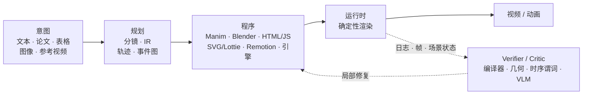

<p align="center">
  
</p>

<p align="center">
  <a href="https://awesome.re"></a>
  <a href="https://github.com/Daryl-GSJ/awesome-code-generated-video"></a>
  <a href="CONTRIBUTING.md"></a>
  <a href="https://github.com/Daryl-GSJ/awesome-code-generated-video/actions/workflows/validate.yml"></a>
  <a href="https://github.com/Daryl-GSJ/awesome-code-generated-video/actions/workflows/links.yml"></a>
  <a href="LICENSE"></a>
  
</p>

<p align="center">
  <b>一份 research-first 的「写程序生成视频」研究地图。</b><br>
  LLM 与智能体编写 Manim、Blender Python、HTML/CSS/JS、SVG/Lottie、Remotion、Three.js 或仿真代码；<br>
  再由明确的运行时执行这些代码并渲染出动画。
</p>

<p align="center">
  <a href="README.md">English</a> · <b>简体中文</b> ·
  <a href="taxonomy.md">分类法</a> ·
  <a href="research-gaps.md">开放问题</a> ·
  <a href="analysis.md">统计分析</a> ·
  <a href="data/papers.json">papers.json</a> ·
  <a href="data/resources.json">resources.json</a>
</p>

<table align="center">
  <tr>
    <td align="center"><b>68</b><br><sub>论文与工作</sub></td>
    <td align="center"><b>23</b><br><sub>核心</sub></td>
    <td align="center"><b>11</b><br><sub>支撑</sub></td>
    <td align="center"><b>34</b><br><sub>邻近</sub></td>
    <td align="center"><b>63</b><br><sub>数据集 · Benchmark · 工具</sub></td>
    <td align="center"><b>75%</b><br><sub>含 verifier-like 检查</sub></td>
  </tr>
</table>

---

## 动态

- **2026-10-27**：目录更新，新增 6 项工作（TeachMaster、OmniLottie、VibeVideoBench、Code Video Model、VisPhyWorld、Paper2Video）和 15 项资源，并修正 TheoremExplainAgent、InternSVG、VAnim 的元数据。
- **2026-10**：[VibeVideoBench](https://arxiv.org/abs/2610.35864) 给 coding agent 布置 239 个中英双语任务，要求 1 小时内交付带声音的 MP4。约 3/4 的失分视频，问题出在最终渲染启动过晚、渲染过慢或根本没有启动。
- **2026-10**：[Code2Video-Compass](https://arxiv.org/abs/2610.28416) 是目前覆盖面最广的直接 benchmark，包含 2,104 个 T2V/I2V/V2V 任务，基于 Remotion Web 技术栈。
- **2026-10**：逆向 video→code 工作开始规模化：[4DCodeBench](https://arxiv.org/abs/2610.03715)、[PhySimCode](https://arxiv.org/abs/2610.15722)；[Reels-RSI](https://arxiv.org/abs/2610.14495) 则在程序层面做自我改进。
- **2026**：会议季：[OmniLottie](https://arxiv.org/abs/2603.02138) 与 [LottieGPT](https://arxiv.org/abs/2604.11792) 中 CVPR，[Code2Video](https://arxiv.org/abs/2510.01174) 与 [VAnim](https://arxiv.org/abs/2605.01517) 中 ICML，[TeachMaster](https://arxiv.org/abs/2601.04204) 中 ACL，[ManimAgent](https://arxiv.org/abs/2606.30296) 中 EMNLP。

## 目录

- [什么是代码生成视频](#什么是代码生成视频)
- [核心论文](#核心论文)
  - [教育与讲解视频](#教育与讲解视频)
  - [Web、矢量与动态图形](#web矢量与动态图形)
  - [数据、3D 与仿真视频](#数据3d-与仿真视频)
- [支撑工作：Benchmark、Verifier、逆向与混合](#支撑工作benchmarkverifier逆向与混合)
- [邻近工作](#邻近工作)
- [数据集与 Benchmark](#数据集与-benchmark)
- [运行时、工具与 Agent Harness](#运行时工具与-agent-harness)
- [全景速览](#全景速览)
- [研究观察](#研究观察)
- [开放问题](#开放问题)
- [仓库结构、数据模型与方法](#仓库结构数据模型与方法)
- [参与贡献](#参与贡献) · [引用](#引用) · [相关列表](#相关列表)

## 什么是代码生成视频

像素空间视频模型直接采样画面帧。**代码生成视频**的做法不同：模型先写出一个**带时间语义的可执行程序**，再由确定性运行时把它渲染出来。这样做有四个好处：

- **精确**：文字、公式和几何图形始终清晰锐利。
- **可编辑**：改一行代码，重新渲染即可。
- **可验证**：日志、场景图和引擎状态都可以拿来检查。
- **可复现**：同一程序总能渲染出同一段视频。



收录的工作分为三层：

- **核心**：模型生成或实质修改带时间语义的可执行视觉表示，由明确运行时执行，且动画或视频是主要输出或评价目标。
- **支撑**：benchmark、verifier、逆向 video→code 重建，以及 code→pixel 混合系统。
- **邻近**：静态视觉或 3D 程序生成，且有明确路径扩展到时间维度。

以下不收录：纯像素视频生成、仅把代码当作输入条件的模型、只产出文字脚本或分镜的系统。可操作的判定规则与边界案例见 [`taxonomy.md`](taxonomy.md)。

| 维度 | 收录范围 |
|---|---|
| **输入** | 文本、论文、定理/题目、表格、图像/关键帧、参考视频、已有工程 + 编辑指令 |
| **程序** | Manim/Blender Python、HTML/CSS/JS、D3.js、SVG/CSS/SMIL、Lottie JSON、Remotion、Three.js、引擎/仿真代码、typed IR/DSL |
| **任务** | T2V-code、I2V-code、V2V-code、edit-code、长讲解视频、数据故事、动态图形、物理/3D/过场动画 |
| **反馈** | 编译器/运行时日志、renderer-in-the-loop、VLM critic、符号几何、时序谓词、schema/测试、人工把关 |
| **评测** | 安全性、完整渲染、空间/时间/语义正确性、编辑局部性、任务结果、可复现性、全周期成本 |

## 核心论文

> 每组内按年份排序。**程序**指可执行表示，**反馈**指闭环机制。每项工作的具体数字、适用范围与局限见[研究简报](research/core.md)。

### 教育与讲解视频

| 论文 | 发表 | 程序 | 反馈 | 链接 |
|---|---|---|---|---|
| **TheoremExplainAgent**：数分钟长的 STEM 定理讲解 | ACL 2025 | 故事规划 → Manim + 旁白 | 执行检查 | [论文](https://arxiv.org/abs/2502.19400) · [代码](https://github.com/TIGER-AI-Lab/TheoremExplainAgent) · [项目](https://tiger-ai-lab.github.io/TheoremExplainAgent/) |
| **Manimator**：论文/PDF → 可视化讲解 | arXiv 2025 | Markdown 场景规划 → Manim | 开环（无视频反馈） | [论文](https://arxiv.org/abs/2507.14306) · [代码](https://github.com/HyperCluster-Tech/manimator) |
| **Code2Video**：以代码为中心的教学视频 | ICML 2026 | 分镜 → Manim | 编译反馈、视觉锚点 VLM critic、TeachQuiz | [论文](https://arxiv.org/abs/2510.01174) · [代码](https://github.com/showlab/Code2Video) · [项目](https://showlab.github.io/Code2Video/) |
| **TeachMaster**：以代码生成教学视频，已规模化部署 | ACL 2026 | 讲义规划 → Manim + TTS 时间对齐 | 执行、时间对齐与布局校验 | [论文](https://arxiv.org/abs/2601.04204) · [项目](https://www.teachmaster.cn/) |
| **LASEV**：可部署级多智能体教学视频 | KDD 2026 | 受约束的可执行脚本 + 模板 | 语义 critic、规则 | [论文](https://arxiv.org/abs/2602.11790) · [项目](https://robitsg.github.io/LASEV/) |
| **ALGOGEN**：可验证的算法可视化轨迹 | Findings of ACL 2026 | Python tracker → VTA-JSON → 多后端 | schema 校验、测试用例 | [论文](https://arxiv.org/abs/2605.12159) · [代码](https://github.com/MAC-AutoML/ALGOGEN-lab) · [ACL Anthology](https://aclanthology.org/2026.findings-acl.156/) |
| **ManimAgent**：自进化多模态智能体 | EMNLP 2026 | Manim + 情景记忆 | VLM critic、跨任务成功/失败记忆 | [论文](https://arxiv.org/abs/2606.30296) · [代码](https://github.com/jwj1342/Paper2Manim) · [项目](https://manimagent.github.io/) |
| **LLM2Manim**：教学法感知的 STEM 动画 | arXiv 2026 | 教学规划 + 符号账本 → Manim | 代码自修复、专家把关 | [论文](https://arxiv.org/abs/2604.05266) |
| **PhysicsSolutionAgent**：数值物理题讲解 | arXiv 2026 | 分镜 → Manim + 旁白 | 运行日志、截图 VLM 反馈 | [论文](https://arxiv.org/abs/2601.13453) · [代码](https://github.com/f20220374/PhysicsSolutionAgent) |
| **ManimTrainer / ManimAgent**：Manim 训练 + 智能体推理 | arXiv 2026 | Manim | SFT/GRPO、renderer-in-the-loop、文档检索 | [论文](https://arxiv.org/abs/2604.18364) · [代码](https://github.com/SuienS/manim-trainer) |
| **ANVIL**：面向讲师的类比与视频 | Springer 章节 2026 | 类比 → 剧本 → Manim | 静态分析、执行修复、教师审阅 | [论文](https://arxiv.org/abs/2605.16295) · [代码](https://github.com/yurinoviello/AI_Metaphors) |

### Web、矢量与动态图形

| 论文 | 发表 | 程序 | 反馈 | 链接 |
|---|---|---|---|---|
| **Keyframer**：LLM 辅助动画设计 | CHI 2024 | SVG + CSS 动画 | 人工迭代提示、属性控件 | [论文](https://arxiv.org/abs/2402.06071) |
| **LogoMotion**：视觉 grounded 的 logo 动画代码合成 | CHI 2025 | JavaScript 动画 | 视觉修复、代码联动控件 | [论文](https://arxiv.org/abs/2405.07065) |
| **MG-Gen**：单图 → 动态图形 | arXiv 2025 | 分层 HTML + JavaScript 动画 | — | [论文](https://arxiv.org/abs/2504.02361) · [代码](https://github.com/CyberAgentAILab/MG-GEN) |
| **DATAREEL**：数据驱动的视频故事 | arXiv 2026 | 动画规划 → HTML / D3.js | 规划 critic、视频 VLM critic | [论文](https://arxiv.org/abs/2604.25220) · [代码](https://github.com/vis-nlp/DataReel) |
| **InternSVG**：统一 SVG 任务，含文本/视频 → 动画 SVG | ICLR 2026 | SVG/XML 动画 | 解析 + 渲染评测 | [论文](https://arxiv.org/abs/2510.11341) · [代码](https://github.com/hmwang2002/InternSVG) · [项目](https://hmwang2002.github.io/release/internsvg/) |
| **LottieGPT**：矢量动画 tokenization | CVPR 2026 | Lottie JSON 动画 token | 解析 + 渲染校验 | [论文](https://arxiv.org/abs/2604.11792) · [代码](https://github.com/yisuanwang/LottieGPT) · [项目](https://lottiegpt.github.io/) |
| **OmniLottie**：文本/图像/视频 → 可编辑 Lottie | CVPR 2026 | 参数化 Lottie 命令 token | 解析 + 渲染校验、五级失败分类 | [论文](https://arxiv.org/abs/2603.02138) · [代码](https://github.com/OpenVGLab/OmniLottie) · [项目](https://openvglab.github.io/OmniLottie/) |
| **VAnim**：渲染感知的稀疏状态建模 | ICML 2026 | 持久 SVG DOM + 稀疏状态更新 | 视频感知奖励 | [论文](https://arxiv.org/abs/2605.01517) · [项目](https://yukinonooo.github.io/VAnimProject) |
| **Reels-RSI**：讲解短视频的程序级自我改进 | arXiv 2026 | HTML / SVG / Canvas / Three.js | lint、运行时检查、可执行规则、人工把关 | [论文](https://arxiv.org/abs/2610.14495) · [代码](https://github.com/agentic-loops-x/Reels-RSI) |

### 数据、3D 与仿真视频

| 论文 | 发表 | 程序 | 反馈 | 链接 |
|---|---|---|---|---|
| **Data Director**：表格洞察 → 动画数据视频 | IEEE VIS 2024（作者稿） | Vega-Lite / SVG + 时间线 + 音频 | 工作流迭代 | [论文](https://arxiv.org/abs/2408.03876) |
| **Kubrick**：Blender 中的多智能体合成视频 | CVPR AI4CC Workshop 2024 | Blender Python | VLM critic、render-in-the-loop | [论文](https://arxiv.org/abs/2408.10453) |
| **SimuScene**：物理启发动画代码的训练与评测 | arXiv 2026 | 可执行动画代码 | 执行、VLM 验证问题 | [论文](https://arxiv.org/abs/2602.10840) |

## 支撑工作：Benchmark、Verifier、逆向与混合

| 工作 | 角色 | 发表 | 贡献 | 链接 |
|---|---|---|---|---|
| **MoVer** | verifier | ACM TOG / SIGGRAPH 2025 | 基于 GSAP/SVG 运动的时空谓词 DSL；verify → repair 闭环 | [论文](https://arxiv.org/abs/2502.13372) · [代码](https://github.com/jama1017/MoVer) · [项目](https://mover-dsl.github.io/) |
| **SGA** | verifier | arXiv 2026 | 即插即用的 Manim 布局符号场景图几何检查 | [论文](https://arxiv.org/abs/2607.18116) · [项目](https://jhedlp.github.io/projects/sga/) |
| **ManiBench** | benchmark | LOCUS 2026 | Manim CE 版本幻觉与视觉逻辑漂移 | [论文](https://arxiv.org/abs/2603.13251) · [代码](https://github.com/nabin2004/ManiBench) |
| **Code2Video-Compass** | benchmark | arXiv 2026 | 2,104 个 T2V/I2V/V2V 任务、10 类，Remotion Web 技术栈 | [论文](https://arxiv.org/abs/2610.28416) · [代码](https://github.com/code2video-compass/Code2Video-Compass) · [项目](https://code2video-compass.github.io/) |
| **VibeVideoBench** | agent benchmark | arXiv 2026 | 239 个任务、9 个智能体系统、2,151 次 rollout；程序检查 → rubric → VLM 评审团 → 人类偏好 | [论文](https://arxiv.org/abs/2610.35864) · [项目](https://vibevideobench.github.io/) |
| **Animation2Code** | 逆向 | arXiv 2026 | video → HTML/CSS/JS，外观与时序相似度分开评分 | [论文](https://arxiv.org/abs/2606.28593) · [项目](https://anya-ji.github.io/animation2code-website/) |
| **PhySimCode** | 逆向 | arXiv 2026 | 物理视频 → 定律、参数与仿真代码 | [论文](https://arxiv.org/abs/2610.15722) · [代码](https://github.com/SourajaKundu/PhySimCode) · [项目](https://sourajakundu.github.io/PhySimCode/) |
| **VisPhyWorld** | 逆向 | arXiv 2026 | 209 个物理场景；97.7% 能正常渲染，但 SVG/Manim 后端丢失物理一致性 | [论文](https://arxiv.org/abs/2602.13294) · [代码](https://github.com/TIGER-AI-Lab/VisPhyWorld) · [项目](https://tiger-ai-lab.github.io/VisPhyWorld/) |
| **4DCodeBench** | 逆向 | arXiv 2026 | 智能体把动态场景重建为可执行的 4D（Blender）程序 | [论文](https://arxiv.org/abs/2610.03715) · [代码](https://github.com/4DCodeBench/4DCodeBench) · [项目](https://4dcodebench.com/) |
| **VideoCoCo** | 混合 | arXiv 2026 | 以 Blender 时空草稿作为 code-as-CoT，生成物理一致的像素 | [论文](https://arxiv.org/abs/2607.27380) · [代码](https://github.com/micky-li-hd/VideoCoCo) |
| **Code Video Model** | 混合 | 技术报告 2026 | 用 Three.js proxy 视频 + 参考图引导预训练视频模型 | [报告](https://code-video-model.github.io/tech_report.pdf) · [代码](https://github.com/code-video-model/CodeVideoModel) · [项目](https://code-video-model.github.io/) |

## 邻近工作

本节涵盖静态视觉或 3D 程序生成、引擎与世界构建，以及基于幻灯片的视频。这些工作都不以视频为首要目标，但各自提供的表示、verifier 或数据管线可以迁移到时间维度。

<details>
<summary><b>矢量图形与前端程序</b>（12）</summary>

| 工作 | 发表 | 程序 | 链接 |
|---|---|---|---|
| DeepSVG | NeurIPS 2020 | 层级 SVG 命令 | [论文](https://arxiv.org/abs/2007.11301) |
| Spellburst | UIST 2023 | p5.js 节点图 | [论文](https://arxiv.org/abs/2308.03921) |
| Breathing Life Into Sketches（LiveSketch） | arXiv 2023 | 随时间变化的矢量笔画 | [论文](https://arxiv.org/abs/2311.13608) · [项目](https://livesketch.github.io/) |
| StarVector | arXiv 2024 | SVG 代码 | [论文](https://arxiv.org/abs/2312.11556) |
| Design2Code | arXiv 2024 | HTML / CSS | [论文](https://arxiv.org/abs/2403.03163) · [代码](https://github.com/NoviScl/Design2Code) |
| DeTikZify | NeurIPS 2024 | TikZ | [论文](https://arxiv.org/abs/2405.15306) · [代码](https://github.com/potamides/detikzify) |
| OmniSVG | NeurIPS 2025 | SVG 代码 | [论文](https://arxiv.org/abs/2504.06263) · [项目](https://omnisvg.github.io/) |
| VectorGym | arXiv 2026 | SVG 代码 | [论文](https://arxiv.org/abs/2603.29852) |
| Hierarchical SVG Tokenization | arXiv 2026 | 层级 SVG token | [论文](https://arxiv.org/abs/2604.05072) |
| Render-in-the-Loop | arXiv 2026 | SVG 代码 + 视觉自反馈 | [论文](https://arxiv.org/abs/2604.20730) |
| LiveSVG | arXiv 2026 | 组单应变换 + Bézier 偏移 | [论文](https://arxiv.org/abs/2605.30174) · [项目](https://levymsn.github.io/LiveSVG/) |
| CANVAS | arXiv 2026 | SVG 代码 | [论文](https://arxiv.org/abs/2608.30689) |

</details>

<details>
<summary><b>3D 场景与资产程序</b>（12）</summary>

| 工作 | 发表 | 程序 | 链接 |
|---|---|---|---|
| 3D-GPT | arXiv 2023 | Blender Python、程序化函数 | [论文](https://arxiv.org/abs/2310.12945) · [项目](https://chuny1.github.io/3DGPT/3dgpt.html) |
| Holodeck | CVPR 2024 | 空间约束 → AI2-THOR 场景 | [论文](https://arxiv.org/abs/2312.09067) · [代码](https://github.com/allenai/Holodeck) |
| SceneCraft | ICML 2024 | 场景图 → Blender Python | [论文](https://arxiv.org/abs/2403.01248) |
| BlenderAlchemy | ECCV 2024 | Blender 节点图编辑 | [论文](https://arxiv.org/abs/2404.17672) · [项目](https://ianhuang0630.github.io/BlenderAlchemyWeb/) |
| The Scene Language | arXiv 2024 | 层级场景程序 | [论文](https://arxiv.org/abs/2410.16770) |
| Scene Co-pilot | arXiv 2024 | Infinigen + Blender Python | [论文](https://arxiv.org/abs/2411.18644) · [项目](https://abolfazl-sh.github.io/Scene_co-pilot_site/) |
| BlenderLLM | arXiv 2024 | Blender Python（bpy） | [论文](https://arxiv.org/abs/2412.14203) · [代码](https://github.com/FreedomIntelligence/BlenderLLM) |
| LL3M | arXiv 2025 | 模块化 Blender Python | [论文](https://arxiv.org/abs/2508.08228) · [代码](https://github.com/threedle/ll3m) |
| SceneCode | arXiv 2026 | 可执行世界程序 | [论文](https://arxiv.org/abs/2605.19587) · [代码](https://github.com/wangpuyi/SceneCode) |
| 3DCodeBench | arXiv 2026 | 独立 Blender 5.0 脚本 | [论文](https://arxiv.org/abs/2606.01057) · [代码](https://github.com/gaoypeng/3dcodebench) |
| Nova3D | arXiv 2026 | Blender 源码 + 装配树 + 关节 | [论文](https://arxiv.org/abs/2607.22738) · [代码](https://github.com/RareSense/Nova3D) |
| Agentic 3D Creation（aDSL） | arXiv 2026 | aDSL 组件 + 关系算子 | [论文](https://arxiv.org/abs/2608.17975) · [代码](https://github.com/sig-pku/aDSL) |

</details>

<details>
<summary><b>引擎、仿真、影视与幻灯片</b>（10）</summary>

| 工作 | 发表 | 程序 | 链接 |
|---|---|---|---|
| GPT4Motion | CVPR Workshop 2024 | Blender 物理 → 控制序列 | [论文](https://arxiv.org/abs/2311.12631) · [代码](https://github.com/jiaxilv/GPT4Motion) |
| RoboGen | ICML 2024 | 仿真场景 + 奖励代码 | [论文](https://arxiv.org/abs/2311.01455) · [代码](https://github.com/Genesis-Embodied-AI/RoboGen) |
| FilmAgent | SIGGRAPH Asia 2024 | 剧本 JSON → Unity 演员/相机指令 | [论文](https://arxiv.org/abs/2501.12909) · [代码](https://github.com/HSwotch/FilmAgent) |
| UnrealLLM | Findings of ACL 2025 | UE5 PCG + 蓝图配置 | [论文](https://aclanthology.org/2025.findings-acl.994/) · [代码](https://github.com/XGRIDS-3D/Interactive-3D-Scene-Creation-via-LLM-Driven-Procedural-Generation) |
| Paper2Video（PaperTalker） | arXiv 2025 | Beamer 幻灯片 + 光标 + TTS + 数字人 | [论文](https://arxiv.org/abs/2510.05096) · [代码](https://github.com/showlab/Paper2Video) |
| AutoUE | arXiv 2026 | UE PCG 图 + C++ 玩法 | [论文](https://arxiv.org/abs/2603.07106) · [代码](https://github.com/Pluto156/AutoUE) |
| Authoring for Living Worlds | arXiv 2026 | GEST 事件图 | [论文](https://arxiv.org/abs/2604.10383) · [代码](https://github.com/ncudlenco/multiagent_story_system/releases/tag/v1.1-eccv2026) |
| Cutscene Agent | arXiv 2026 | 引擎工具调用轨迹 | [论文](https://arxiv.org/abs/2604.25318) · [项目](https://kuaishou-gamemind.github.io/cutscene_agent/) |
| GS-Agent | arXiv 2026 | 物理场景 + 相机/灯光代码 | [论文](https://arxiv.org/abs/2607.21522) · [项目](https://umass-embodied-agi.github.io/gs-agent/) |
| Code4Scene | arXiv 2026 | Unreal 构建/编辑代码 | [论文](https://arxiv.org/abs/2609.36777) · [项目](https://simworld-ai-code4scene.static.hf.space/index.html) |

</details>

## 数据集与 Benchmark

| 资源 | 类型 | 规模 / 任务 | 后端 | 边界 |
|---|---|---|---|---|
| [Code2Video-Compass](https://github.com/code2video-compass/Code2Video-Compass) | benchmark | 2,104 个 T2V/I2V/V2V 任务、10 类 | Remotion + HTML/SVG/Canvas/Three.js | 直接覆盖面最广；修复与安全赛道仍较薄 |
| [VibeVideoBench](https://vibevideobench.github.io/) | agent benchmark | 239 个双语任务、12 类；1 小时内交付带音频的 MP4 | 由智能体自选（Manim、Remotion、Three.js、HTML…） | 代码标注 "coming soon"；单视频层面评审仅中等一致 |
| [Animation2Code](https://huggingface.co/datasets/anim2code/dataset) | 数据集 | 1,069 对 Web 动画视频 ↔ 代码 | HTML/CSS/JS | 短 Web 动画 |
| [MMMC](https://github.com/showlab/Code2Video) | 数据集 | 覆盖 13 个学科的专业 Manim 教程 | Manim | 限于教育领域 |
| [TheoremExplainBench](https://tiger-ai-lab.github.io/TheoremExplainAgent/) | benchmark | 240 个定理、4 个 STEM 学科 | Manim | 长讲解视频 |
| [ALGOGEN-Bench](https://github.com/MAC-AutoML/ALGOGEN-lab) | benchmark | 带可验证轨迹的算法可视化 | 多后端 | 限于算法领域 |
| [MoVer prompts](https://github.com/jama1017/MoVer) | 数据集 | 5,600 条 prompt + 时空验证程序 | GSAP / SVG | 预定义的 2D 谓词词表 |
| [ManiBench](https://github.com/nabin2004/ManiBench) | benchmark | Manim CE 幻觉与视觉逻辑漂移 | Manim CE | 12 题试点 |
| [ManimBench-v1](https://huggingface.co/datasets/SuienR/ManimBench-v1) | 数据集 | Manim 代码 ↔ 描述对 | Manim | 需清理泄漏与许可问题 |
| [SimuScene](https://arxiv.org/abs/2602.10840) | benchmark | 7,659 个场景、52 个概念；334 个人工验证测试用例 | 可执行动画代码 | 物理启发的 2D 场景 |
| [DATAREEL](https://github.com/vis-nlp/DataReel) | 数据集 | 表格 → 动画数据故事 | HTML / D3.js | 限于数据视频 |
| [LottieBench](https://lottiegpt.github.io/) · [LottieAnimation-660K](https://github.com/yisuanwang/LottieGPT) | benchmark + 数据 | Lottie 生成 | Lottie JSON | 受 tokenizer 特性子集限制 |
| [MMLottieBench](https://huggingface.co/datasets/OmniLottie/MMLottieBench) · [MMLottie-2M](https://huggingface.co/datasets/OmniLottie/MMLottie-2M) | benchmark + 数据 | 多模态文本/图像/视频 → Lottie | Lottie JSON | 受 tokenizer 特性子集限制 |
| [SAgoge / SArena](https://hmwang2002.github.io/release/internsvg/) | 数据 + benchmark | 统一的 SVG 理解、编辑与动画 | SVG | 动画只是众多任务之一 |
| [PhySimCode](https://github.com/SourajaKundu/PhySimCode) | benchmark | 物理视频 → 仿真代码 | Python / SciPy | 程序化领域差距；存在多个有效解 |
| [VisPhyBench](https://github.com/TIGER-AI-Lab/VisPhyWorld) | benchmark | 108 个模板生成 209 个场景 | Three.js、P5.js、SVG、Manim | 仅合成刚体 |
| [4DCodeBench](https://github.com/4DCodeBench/4DCodeBench) | benchmark | 视频 → 可执行动态 3D 场景 | Blender | 执行成本高 |
| [CodeVideoBench](https://huggingface.co/datasets/code-video-model/CodeVideoBench) | benchmark | 代码 proxy 条件下的视频生成 | Three.js → 视频模型 | 评审由作者定义 |
| [Paper2Video](https://github.com/showlab/Paper2Video) | benchmark | 101 篇论文 + 作者报告视频；PresentQuiz、IP Memory | Beamer | 幻灯片，而非动画程序 |
| [3DCodeBench](https://github.com/gaoypeng/3dcodebench) · [Code4Scene](https://simworld-ai-code4scene.static.hf.space/index.html) | benchmark | Blender 资产 / 持久化 Unreal 场景 | Blender / UE | 与视频邻近 |

可迁移的视频、编辑与代码执行 benchmark（VBench、EvalCrafter、T2V-CompBench、TC-Bench、PhyGenBench、IVEBench、VEFX-Bench、ViTeX-Bench 等）收录在 [`data/resources.json`](data/resources.json) 中，讨论见 [`research/evaluation.md`](research/evaluation.md)。

## 运行时、工具与 Agent Harness

| 层级 | 项目 | 典型用途 |
|---|---|---|
| **数学与讲解** | [Manim Community](https://www.manim.community/) | 用 Python 编写 STEM 讲解场景；目录中最常见的目标 |
| **Web 视频** | [Remotion](https://www.remotion.dev/) · [Motion Canvas](https://motioncanvas.io/) · [HyperFrames](https://github.com/heygen-com/hyperframes) | 把 React/TypeScript/HTML 组合逐帧精确渲染为 MP4 |
| **浏览器图形** | [Three.js](https://threejs.org/) · [p5.js](https://p5js.org/) · [GSAP](https://gsap.com/) | 3D 场景、物理 proxy、创意编程与时间线动画 |
| **矢量动画** | [Lottie](https://airbnb.io/lottie/) | 声明式 JSON 动画，提供跨平台播放器 |
| **3D 与 DCC** | [Blender](https://www.blender.org/) | 用 bpy 脚本控制场景、相机、物理与过场动画 |
| **程序化 / 真值** | [Infinigen](https://github.com/princeton-vl/infinigen) · [Kubric](https://github.com/google-research/kubric) · [BlenderProc](https://github.com/DLR-RM/BlenderProc) · [AI2-THOR](https://github.com/allenai/ai2thor) | 生成带标注的合成场景，用于数据与验证 |
| **Agent Harness** | [BlenderGPT](https://github.com/gd3kr/BlenderGPT) · [BlendHarness](https://github.com/cccky0813/BlendHarness) · [blender-agent-studio](https://github.com/ifBars/blender-agent-studio) · [blenderwright](https://github.com/HoldMyBeer-gg/blenderwright) | 通过工具/MCP 把 LLM 智能体接入 Blender |
| **评测基础设施** | [VBench](https://github.com/Vchitect/VBench) · [VMAF](https://github.com/Netflix/vmaf) · [InterCode](https://github.com/princeton-nlp/intercode) · [HumanEval](https://github.com/openai/human-eval) | 可迁移的组件，不能直接证明代码视频质量 |

## 全景速览

以下图表由 [`scripts/generate_charts.py`](scripts/generate_charts.py) 从 JSON 数据可复现地生成，口径定义见 [`analysis.md`](analysis.md)。

- **40/68** 项工作发表于 2026 年。
- **62/68（91.2%）** 报告了反馈机制。
- **51/68（75.0%）** 包含针对执行、渲染、结构、符号、指标、规则、测试或状态的 verifier-like 检查。

<table>
  <tr>
    <td width="50%"></td>
    <td width="50%"></td>
  </tr>
  <tr>
    <td align="center"><sub>按年份与分层的目录覆盖</sub></td>
    <td align="center"><sub>最常见的精确表示标签</sub></td>
  </tr>
  <tr>
    <td width="50%"></td>
    <td width="50%"></td>
  </tr>
  <tr>
    <td align="center"><sub>反馈与 verifier-like 覆盖率</sub></td>
    <td align="center"><sub>相关性构成与资源类型</sub></td>
  </tr>
</table>

## 研究观察

1. **代码能跑，不等于运动正确。** 在 Animation2Code 中，可执行性和外观分数与时序重建质量脱钩。VisPhyWorld 有 97.7% 的重建能正常渲染，但 SVG/Manim 后端的物理是错的。物理与 4D benchmark 也显示出同样的静态正确与动态正确之间的差距。
2. **表示选择本身就是算法选择。** 持久对象与稀疏状态更新（VAnim）、可验证轨迹（ALGOGEN）、Lottie 命令 token（LottieGPT、OmniLottie）以及受约束的事件图，都能减少身份漂移，并让局部修复成为可能。
3. **结构化证据优于泛化的自我反思。** 编译日志、几何检查（SGA）、时序谓词（MoVer）、schema 与引擎状态，比没有依据的 VLM 打分更能精确定位错误。VLM 更适合评判语义与构图。
4. **长视频本质上是状态管理问题。** 随着时长和依赖深度增加，布局、旁白对齐和跨场景连续性都会变差；TeachMaster 和 LASEV 为此增加了显式的时间与模板层。
5. **智能体不只败在代码上，也败在时间预算上。** 在 VibeVideoBench 中，约 3/4 的失分视频源于最终渲染启动过晚、渲染过慢或从未启动。渲染调度本身就是一项核心能力。
6. **评审本身也需要被评估。** 位置偏差、同族偏好、误导性视觉反馈都已被观察到。不同评审在系统排名上一致，但在单个视频上只是中等一致，因此论文应报告 critic 在发现错误、定位错误和避免回归三方面的表现。
7. **单一总分并不可靠。** 应把安全性与完整渲染作为硬门槛，然后分别报告空间、时间、语义正确性，以及可编辑性、任务结果、可复现性与成本。
8. **混合系统有价值，但应单独归类。** 先写代码草稿再生成像素的系统（VideoCoCo、Code Video Model）提升了真实感，但最终渲染不再确定，幻觉可能重新出现。

## 开放问题

| 优先级 | 空白 | 为何重要 |
|---|---|---|
| **P0** | 可复现执行与安全协议 | 生成的代码会运行任意程序，结果必须在沙箱内运行且可重跑 |
| **P0** | 超越可执行性与外观的时序正确性 | 视频可能能渲染、关键帧看起来也对，但运动是错的 |
| **P0** | 经过校准的 critic 与评审 | 误导性的 VLM 反馈会让修复闭环偏离方向 |
| **P1** | 持久场景身份与稀疏时间状态 · 局部修复 vs 整体重生成 | 一次编辑不应重写整个视频 |
| **P1** | 长篇叙事与音画同步 · 教学视频的学习效果 · 构造即有效的时间/物理程序 | 质量不能止步于一次性短片 |
| **P2** | 3D 多视角与隐藏状态验证 · 把混合系统的先验蒸馏回程序 · 数据泄漏、许可与来源追溯 | 负责任地扩展数据与评测 |

完整理由、具体实验与建议的执行顺序见 [`research-gaps.md`](research-gaps.md)。

## 仓库结构、数据模型与方法

```text
├── README.md / README.zh-CN.md   单行可扫读条目
├── taxonomy.md                   定义、分层、收录/排除判定
├── research-gaps.md              按优先级排列的开放问题
├── analysis.md                   可复现统计（自动生成）
├── data/papers.json              每项工作一条去重记录
├── data/resources.json           数据集、benchmark、系统、工具、展示
├── schema/*.schema.json          JSON Schema 2020-12 约束
├── research/*.md                 完整证据简报（core、vector_web、3d_agents、evaluation）
└── scripts/                      validate_data.py、generate_charts.py
```

- **记录**：[`data/papers.json`](data/papers.json) 保存标识符、链接、相关性、表示、生成方式、反馈、任务、数据集、评测、发现与局限。[`data/resources.json`](data/resources.json) 保存数据集、benchmark、系统、工具与展示。CI 会按 [`schema/papers.schema.json`](schema/papers.schema.json) 和 [`schema/resources.schema.json`](schema/resources.schema.json) 校验这两个文件。
- **证据**：完整简报见 [`research/core.md`](research/core.md)、[`research/vector_web.md`](research/vector_web.md)、[`research/3d_agents.md`](research/3d_agents.md) 与 [`research/evaluation.md`](research/evaluation.md)。
- **方法**：
  - 以 arXiv 与全文为准；官方会议页、项目页和代码仓库只用于补充发表信息与产出物。
  - 记录按稳定标识符去重。
  - 发表信息、规模、代码链接和许可一律不做推断；来源冲突时采用更保守的口径。
  - 未知值保留为 `null`/`[]`。
  - 除非另有说明，数字均为作者报告值。

## 参与贡献

非常欢迎贡献。请先阅读 [`CONTRIBUTING.md`](CONTRIBUTING.md)，然后运行：

```bash
git clone https://github.com/Daryl-GSJ/awesome-code-generated-video.git
cd awesome-code-generated-video
pip install -r requirements.txt
python scripts/validate_data.py && python scripts/generate_charts.py
```

一份好的贡献应包含：一手来源、明确的分层理由、真实的核验日期、保守的元数据，以及能通过 schema 校验的 JSON。README 条目保持一行，细节放在 `data/` 与研究简报中。参与须遵守 [`CODE_OF_CONDUCT.md`](CODE_OF_CONDUCT.md)。

## 引用

如果这份地图对你的研究有帮助，欢迎引用：

```bibtex
@misc{awesome_code_generated_video_2026,
  title        = {Awesome Code-Generated Video: A Research Map of Executable Visual Programs for Video Generation},
  author       = {Daryl-GSJ and contributors},
  year         = {2026},
  howpublished = {\url{https://github.com/Daryl-GSJ/awesome-code-generated-video}},
  note         = {Evidence cutoff 2026-10-27}
}
```

## 相关列表

- [awesome-manim](https://github.com/ManimCommunity/awesome-manim)：Manim 社区资源与项目。
- [Awesome-Video-Diffusion](https://github.com/showlab/Awesome-Video-Diffusion)：像素空间视频扩散模型，即互补的另一条范式。

## Star 历史

<a href="https://star-history.com/#Daryl-GSJ/awesome-code-generated-video&Date">
  
</a>

## 许可

仓库元数据以 [CC0-1.0](LICENSE) 发布。所链接的论文、代码与数据集遵循各自的许可。
